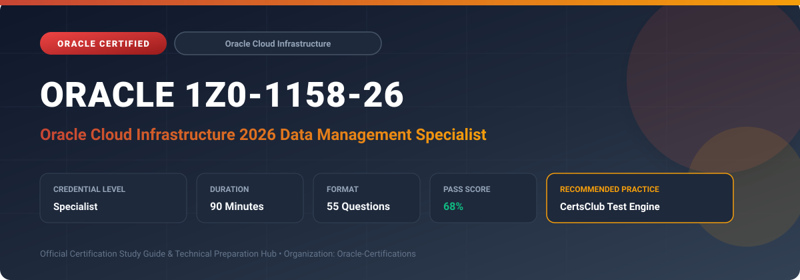

  

# Oracle 1Z0-1158-26: Oracle Cloud Infrastructure 2026 Data Management Specialist

---

## 1. Exam Overview & Candidate Profile

The **Oracle 1Z0-1158-26: Oracle Cloud Infrastructure 2026 Data Management Specialist** certification confirms technical competence in building and orchestrating enterprise data platforms, data lakes, and ETL pipelines on OCI.

Candidates validate expertise across OCI Data Integration, OCI Data Flow (managed Apache Spark), OCI Data Catalog, Autonomous Data Warehouse, Oracle GoldenGate Cloud, and Object Storage data lake architectures.

### Target Audience & Prerequisites
- **Target Roles**: Implementation Specialists, Cloud Architects, Technical Leads, Enterprise Consultants, and Systems Engineers.
- **Recommended Experience**: 1–2 years of practical, hands-on experience designing, implementing, and maintaining corresponding Oracle solutions.
- **Credential Earned**: Specialist Certification.

---

## 2. Key Exam Specifications

| Specification | Details |
| :--- | :--- |
| **Exam Code** | **Oracle 1Z0-1158-26** |
| **Official Title** | Oracle Cloud Infrastructure 2026 Data Management Specialist |
| **Certification Track** | Oracle Cloud Infrastructure |
| **Exam Duration** | 90 Minutes |
| **Number of Questions** | 55 Questions |
| **Passing Score** | 68% |
| **Question Format** | Multiple Choice (Single/Multiple Answer), Scenario-Based Questions |
| **Delivery Provider** | Oracle University / Pearson VUE (Online Proctored or Test Center) |
| **Recommended Practice Engine** | [CertsClub Oracle Practice Tests](https://www.certsclub.com/oracle/1z0-1158-26-dumps.html) |

---

## 3. Official Blueprint & Exam Domain Breakdown

The examination assesses candidate competencies across core functional domains weighted as follows:

| Domain Area | Weighting |
| :--- | :--- |
| **OCI Data Platform Architecture & Lakehouse Design** | `25%` |
| **OCI Data Integration & ETL/ELT Pipeline Automation** | `25%` |
| **Serverless Big Data with OCI Data Flow (Apache Spark)** | `20%` |
| **Metadata Governance with OCI Data Catalog** | `15%` |
| **Data Security, Access Governance & Optimization** | `15%` |

---

## 4. Deep Dive into Complex & Challenging Technical Topics

To secure a passing score on the 1Z0-1158-26 exam, candidates must master the following advanced concepts:

- Designing scalable lakehouse architectures combining OCI Object Storage with Autonomous Data Warehouse.
- Building graphical data flow and integration tasks with OCI Data Integration and scheduling executions.
- Executing serverless, scalable Apache Spark applications using OCI Data Flow without managing clusters.
- Harvesting metadata, creating business glossaries, and tracking data lineage using OCI Data Catalog.
- Streaming real-time change data capture (CDC) using OCI GoldenGate into Kafka/Streaming and target databases.

---

## 5. Scenario-Based Demo & Practice Questions

### Question 1
Which fully managed, serverless OCI service allows data engineers to run Apache Spark processing scripts directly against data in Object Storage without provisioning or configuring Spark clusters?

A) OCI Data Flow
B) Compute Bare Metal
C) Dynamic Routing Gateway
D) Cloud Guard

- **Correct Answer**: `A) OCI Data Flow`  
- **Technical Explanation**: OCI Data Flow is a fully managed, serverless Apache Spark service that enables running big data processing jobs with zero cluster setup and automatic elastic scaling.

---

### Question 2
What OCI service serves as a centralized metadata management repository, harvesting schemas from databases and object storage to provide enterprise data discovery and governance?

A) OCI Data Catalog
B) Service Gateway
C) Vault Secret Store
D) Network Security Group

- **Correct Answer**: `A) OCI Data Catalog`  
- **Technical Explanation**: OCI Data Catalog automatically harvests technical metadata, catalogs data assets across cloud and on-premises environments, and maintains business glossaries.

---

## 6. Recommended Preparation Strategy & Practice Testing Engine

Achieving certification in **Oracle 1Z0-1158-26** requires balanced theoretical study and scenario-based simulation practice:

1. **Review Oracle Documentation**: Master architecture guides, implementation workbooks, and administration manuals on the Oracle Help Center.
2. **Hands-on Lab Practice**: Execute real-world configuration, policy setup, and troubleshooting tasks in your cloud tenancy or test instance.
3. **Simulated Exam Drills**: Practice answering timed, scenario-based multiple-choice questions to familiarize yourself with the question formats, traps, and timing constraints.

### Practice With CertsClub
For realistic practice questions, updated dumps, and mock testing environments:
- **Resource**: [CertsClub Oracle Practice Test Engine](https://www.certsclub.com/oracle/1z0-1158-26-dumps.html)
- **Special Discount**: Use coupon code **`club20`** during checkout for an instant **20% discount** on all practice exam bundles and testing engines.

---

## 7. Official Documentation & References

- [Oracle University Certification Registry](https://education.oracle.com/)
- [Oracle Help Center Documentation Portal](https://docs.oracle.com/)
- [Oracle Cloud Infrastructure & Applications Guides](https://docs.oracle.com/en/cloud/)
- [CertsClub Oracle Certification Exam Practice](https://www.certsclub.com/oracle/1z0-1158-26-dumps.html)

---

## 8. SEO & Discovery Keywords

`oracle 1z0-1158-26, oracle 1z0-1158-26 exam, oracle 1z0-1158-26 dumps, 1Z0-1158-26 practice questions, 1Z0-1158-26 study guide, oracle cloud infrastructure 2026 data management specialist, certsclub 1z0-1158-26`